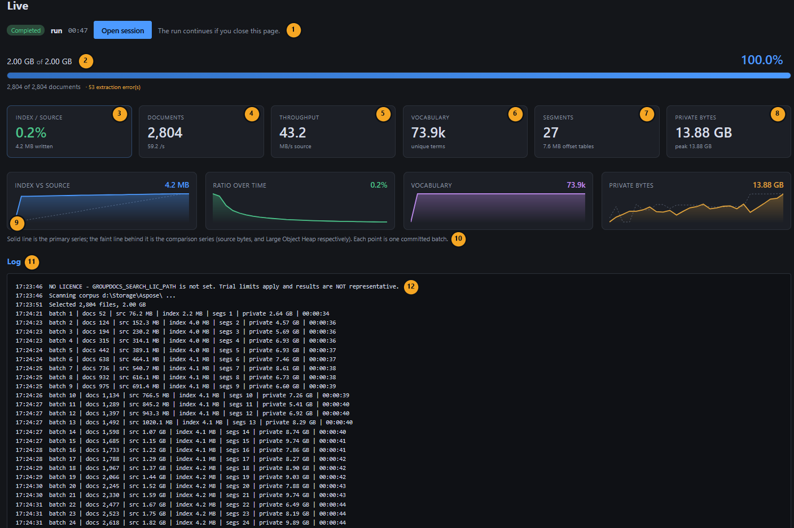

# Indexing Storage Lab

Internal profiling tool for **GroupDocs.Search for .NET**. Runs a bounded slice of any document
corpus through the indexer, records everything about the run as a **session**, and breaks the
resulting index down by where its bytes actually went.

Built to answer a customer question — *why is the index 50–94% of the source size?* — but designed
to outlive it: every session records the product version, runtime and GC mode, so the same corpus
can be re-run on a future Search release and the results compared.

## What a run looks like

The **Live** screen while a run is in flight — and after it finishes, since the record stays on
screen. Numbers on the shot map to the table below.



| | Block | What it means |
|---:|---|---|
| **1** | Run status | State, profile name, elapsed time, and a link to the saved session. The run lives in a hosted singleton service, not in the Blazor circuit — closing the tab, reloading, or losing the websocket does not stop or corrupt it. |
| **2** | Size budget | Source bytes selected against the configured budget, with documents processed and extraction errors underneath. Extraction errors are counted and carried on from, never fatal — 53 of 2,804 files here. |
| **3** | Index / source | The headline ratio: index bytes written ÷ source bytes indexed. Only meaningful alongside the format mix that produced it — see [First results](#first-results). |
| **4** | Documents | Documents indexed so far, and the rate per second. |
| **5** | Throughput | Source megabytes consumed per second. Extraction, not indexing, dominates this. |
| **6** | Vocabulary | Unique terms across the whole index, derived as largest `.head` ÷ 4 — each `.head` is a flat `int[]` indexed by term id, so its length *is* the vocabulary. |
| **7** | Segments | Segment count, and the total bytes of `.head` offset tables. Every segment carries a slot for every term in the whole index, present in that segment or not, so segment count multiplies that cost — this is exactly what `Optimize()` collapses. |
| **8** | Private bytes | Current and peak process private bytes. Sampled on a timer, never at batch boundaries: batch sizes differ between configurations, and a peak read only at commit points measures the batching cadence instead of the memory. |
| **9** | Sparklines | One point per committed batch — index vs. source, ratio over time, vocabulary growth, private bytes vs. Large Object Heap. Shape matters more than the endpoint: a ratio still climbing at the end means the slice was too small. |
| **10** | Series legend | Solid line is the primary series, the faint line behind it is the comparison series. |
| **11** | Log | One line per committed batch — docs, source, index, segments, private bytes, elapsed. The same stream the CLI prints, so a headless run is diagnosable from its console output alone. |
| **12** | Licence line | First line of every run, and the one to read first. |

> The shot above is an **unlicensed** smoke run, kept deliberately because it shows what that looks
> like. Trial mode caps indexing while the tool still produces a complete, plausible-looking
> session — which is why the index at **(3)** flatlines at 4.2 MB and the ratio collapses to 0.2%.
> Nothing here is a real measurement. Sessions stamp `IsLicensed` and the UI marks them, but set a
> licence and do not rely on noticing.

## Why it exists

An index folder is opaque. The only way we could diagnose a customer's 38 GB index was because they
pasted a directory listing into a forum thread. This tool does that analysis automatically:

| Component | What it is |
|---|---|
| `index*.body` | Postings — the real inverted index |
| `index*.head` | Term-offset tables: **4 bytes per term, per segment** |
| `index1.info` | Term dictionary |
| `index.info` | Per-document metadata |

The `.head` files are the interesting part. Each is a flat `int[]` indexed by term id, so every
segment carries a slot for *every term in the whole index* — present in that segment or not. That
gives vocabulary size for free (largest `.head` ÷ 4) and makes the recoverable waste measurable.

## First results

**20 GB of Digital Corpora**, 29,031 documents, GroupDocs.Search 26.8.0, Server GC, one `Optimize()`
at the end. Session `20260826-211200-b87d4c`.

| | before `Optimize()` | after |
|---|---:|---:|
| Index total | 19.85 GB | **2.54 GB** |
| Ratio to source | **99.3%** | 12.7% |
| Segments | 365 (104 empty) | 1 |
| Term offsets (`.head`) | **16.71 GB** (84.2%) | 116.4 MB (4.5%) |
| Vocabulary | 30,500,557 terms | |
| Peak private bytes | 26.15 GB | |
| Total allocated | 3.84 TB | |

Four things worth knowing:

- **An unoptimised index was 99.3% the size of the corpus that produced it** — and 84% of it was not
  index data at all. Each `index{N}.head` is a flat `int[]` indexed by term id, so every segment
  carries four bytes for every term *in the whole index*, present in that segment or not. At 365
  segments and 30.5M terms that is 16.71 GB of mostly `-1` padding.
- **The prediction was exact.** `RecoverableTermOffsetBytes` is computed before the merge as
  `TermOffsetBytes - 4 × vocabulary`; it said 16.60 GB and `.head` actually shrank by 16.59 GB.
- **Segment count is not controllable from the outside.** 260 committed batches produced 365
  segments — the term collector flushes mid-batch once its buffers fill, so batching does not bound
  segment count and 104 of the segments came out empty.
- **The size ratio is dominated by the corpus mix, not by index efficiency.** An HTML-only slice gave
  **57.9%**; a mixed .xls/.ppt/.doc/.pdf slice gave **15.3%**. Any "index as a % of source" figure is
  meaningless without the format mix behind it. In the run above, stored text is 51% of the final
  2.54 GB — turn it off and the index roughly halves.

## Running it

Set a licence first — an unlicensed run is document-capped and every figure becomes meaningless.
The session records whether one was applied. `GROUPDOCS_SEARCH_LIC_PATH` is the only licence setting and
must be the **full path to a `.lic` file** — there is no folder fallback. See
[`.env.example`](.env.example).

```bat
setx GROUPDOCS_SEARCH_LIC_PATH "C:\path\to\GroupDocs.Total.lic"
```

### Point it at a corpus

The committed configuration ships **portable relative defaults** so a fresh clone runs anywhere.
Tell it where your documents are — any folder, any layout, everything underneath is enumerated:

```bat
setx INDEXING_LAB_CORPUS "D:\my\documents"
```

Or copy `src/IndexingLab.Web/appsettings.local.json.example` to `appsettings.local.json`
(git-ignored) and put absolute paths there. Without a corpus the CLI stops with a message telling
you exactly this rather than failing obscurely.

### Quick start

```bat
build.bat                        :: build everything in Release
run.bat                          :: launch the UI, open a browser at 127.0.0.1:5090
run.bat 5091                     :: ... on a different port
stop.bat                         :: stop a running lab host
test.bat                         :: offline test suite
run-profile.bat                  :: list the headless profiles
run-profile.bat smoke            :: small sanity run
run-profile.bat corpora-30pct    :: a long baseline run
```

A running host holds the build output, so `run.bat` and `build.bat` fail while one is up — that is
ordinary file locking, not a fault. `run.bat` detects it and offers to stop it; `stop.bat` does the
same on its own.

### Web UI

`run.bat`, or directly:

```bash
dotnet run --project src/IndexingLab.Web -c Release
# http://127.0.0.1:5090
```

Three pages: **Sessions** (history), **New run** (configure and start), **Live** (log + cancel).
The run lives in a hosted service, not in the Blazor circuit — closing the browser does not stop it.
[What a run looks like](#what-a-run-looks-like) walks the Live screen block by block.

### Headless

For multi-hour runs where you would rather not keep a web host alive:

```bash
dotnet run --project src/IndexingLab.Cli -c Release -- corpora-30pct
```

Profiles live in `src/IndexingLab.Cli/appsettings.json`. Sessions land in the same folder the web UI
reads, so CLI runs appear in the UI list.

| Profile | What it measures |
|---|---|
| `tiny` | 200 MB — pipeline check, finishes in a minute |
| `smoke` | 2 GB — end-to-end sanity |
| `corpora-20pct` / `corpora-30pct` | The real runs: 60 GB / 90 GB baseline |
| `digits-as-separators` | Same slice with `0123456789+/=` as separators — vocabulary reduction |
| `text-storage-ratio` | Text storage on, to measure extracted-text volume |

## Recipes

`samples/IndexingLab.Recipes` is four runnable answers to the problems this lab surfaces. Each one is
a single self-contained file, and each prints numbers rather than asserting anything.

```
recipes.bat                                             usage
recipes.bat diagnose <indexFolder>                      read-only: what an index is made of
recipes.bat progress <corpus> <indexFolder>             Add/Optimize progress + async cancellable merge
recipes.bat sharded  <corpus> <indexFolder> [perShard]  many small indexes, queried as one
recipes.bat alphabet <corpus> <indexFolder>             vocabulary reduction, measured before/after
```

- **`diagnose`** never constructs an `Index` — it reads file sizes only, so it costs nothing, cannot
  modify anything, and is safe to point at a production folder while a service is using it. It
  reports vocabulary, segment count and how much a merge would recover.
- **`progress`** wires `OperationProgressChanged` and `OptimizationProgressChanged`, then runs
  `Optimize()` with `IsAsync = true` and a `Cancellation`. Both events already ship in the product;
  this is about six lines of wiring, and it is what makes "optimise rarely" an option you can offer
  users instead of an unexplained freeze.
- **`sharded`** builds N small indexes, disposing each before starting the next, then federates the
  query through an `IndexRepository`. Search semantics are unchanged.
- **`alphabet`** indexes the same documents twice — as-is and with `0123456789+/=` reclassified as
  separators — and prints the difference. On a 40-file numeric-heavy sample it cut vocabulary
  149,850 → 2,676 terms and the term dictionary 794 KB → 19 KB. That magnitude is a property of that
  corpus, not a general promise, which is the reason the recipe measures instead of claiming; run it
  on your own subset. It changes tokenisation, so it needs a reindex and it changes what queries
  match.

## Sessions

One JSON file per run, written atomically and flushed every few batches so a killed multi-hour run
still leaves usable data. `SessionRecord` is an append-only schema (`SchemaVersion`) because a future
compare-sessions feature will read these and nothing else.

Each session carries what is needed to judge whether two runs are comparable at all:

- **GroupDocs.Search assembly version**, runtime, OS, architecture, core count
- **Server GC on/off**, build configuration, licence applied
- **Corpus fingerprint** — file count, bytes, per-extension mix, and a SHA-256 over the ordered
  selection, so "these two runs indexed the same files" is checkable rather than assumed
- Full configuration, so a run can be replayed
- Timeline samples, memory peaks, retained heap after a forced collection
- Storage breakdown before and after `Optimize()`

## Configuration notes

**Sampling is stratified by default.** A sorted sequential walk of a corpus organised by format
fills the budget from the alphabetically first folders and never reaches the rest — a 90 GB budget on
`d:\Storage` would be all HTML and PDF. Stratified round-robins across the immediate
subfolders so the mix stays representative at any budget. Set `SamplingMode: "Sequential"` if you
specifically want the sorted walk.

**Images and archives are excluded by default.** They yield no text without OCR, so indexing them
inflates the source side of the ratio while contributing nothing to the index. `d:\Storage`
holds 38.9 GB of images — including them would distort the headline number badly.

**Runs are bounded by a size budget with a file-count guard.** Size is primary because the question
is index-size-as-a-share-of-source, so a size budget makes the ratio directly interpretable and the
run duration predictable.

**`Optimize()` at the end is a config flag.** It merges segments, which collapses the `.head`
overhead — but it takes the same deep-copy path as indexing and allocates an `int[vocabulary]` per
merge step. At large vocabularies it can fail; the failure is recorded in the session rather than
losing the whole run.

## Layout

```
src/IndexingLab.Core/
  CorpusWalker.cs           bounded, reproducible, stratified corpus selection
  IndexRunner.cs            executes a run, keeps the session updated
  IndexStorageAnalyzer.cs   the .body/.head/dictionary breakdown
  MemorySampler.cs          background peak sampling, retained-after-GC measurement
  SessionRecord.cs          the durable schema
  SessionStore.cs           atomic JSON persistence
src/IndexingLab.Web/        Blazor Server UI + hosted runner
src/IndexingLab.Cli/        headless runner + profiles
tests/IndexingLab.Tests/    offline suite - no corpus, no licence, no network
docs/images/                screenshots used by this README
```

## Documentation

| Document | What it is |
|---|---|
| [AGENTS.md](AGENTS.md) | Invariants, commands, architecture. The single source of truth for coding agents. |
| [docs/known-issues.md](docs/known-issues.md) | What is currently wrong or misleading. Check a surprising result here first. |
| [docs/tech-debt.md](docs/tech-debt.md) | Deliberate compromises and why. |
| [docs/backlog.md](docs/backlog.md) | Wanted capability, and what was rejected. |
| [changelog/](changelog/) | One numbered file per version, with the findings each produced. |

## Not done yet

- **Compare sessions.** The schema is built for it; the feature is not written. See
  [docs/backlog.md](docs/backlog.md).
- **Charts.** The timeline is a table; the JSON is there if you want to plot it.

## Licence

Sample code: [MIT](LICENSE). GroupDocs.Search is a commercial product with
[its own terms](https://purchase.groupdocs.com/policies/).
